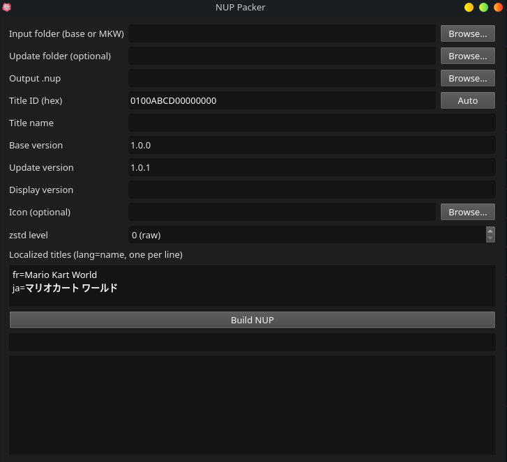

# NUPPacker

An UI to pack switch 2 dumps into NUP files

Note: Spec: https://github.com/a55uka/nup/blob/meow/SPEC.md

### Input folder layout

Pick the root folder; the packer auto-detects:

    base/                     exefs/ + romfs/ of the base game
    updates/<version>/         exefs/ + romfs/ per update; <version> = NCM version number (e.g. 65500)
    dlc/<titleid>/[<version>/] romfs/ per add-on; <titleid> = 16 hex digits

You can also pick a single package folder (one containing exefs/ or romfs/) directly.
Updates are applied over the base using path shadowing; only the highest version is used by Eglantine,
so make it a complete (cumulative) tree. DLC is stored but not mounted by Eglantine yet.
